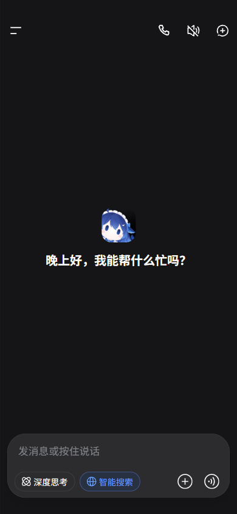
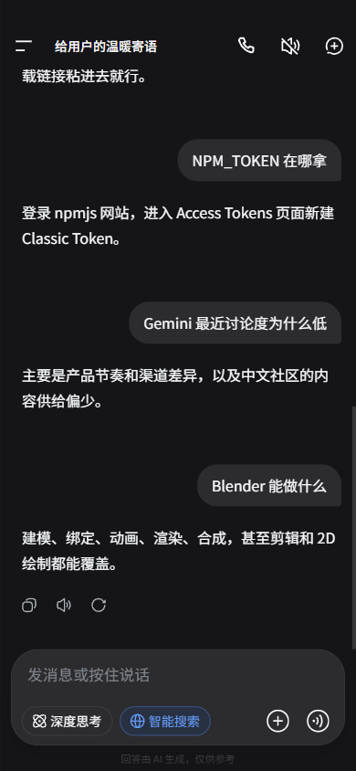
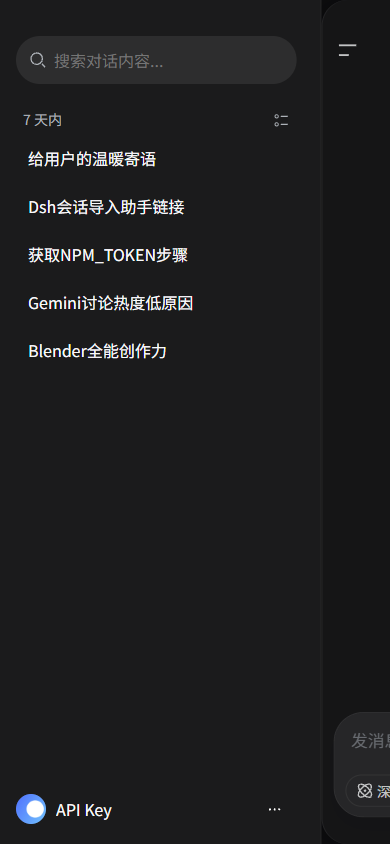
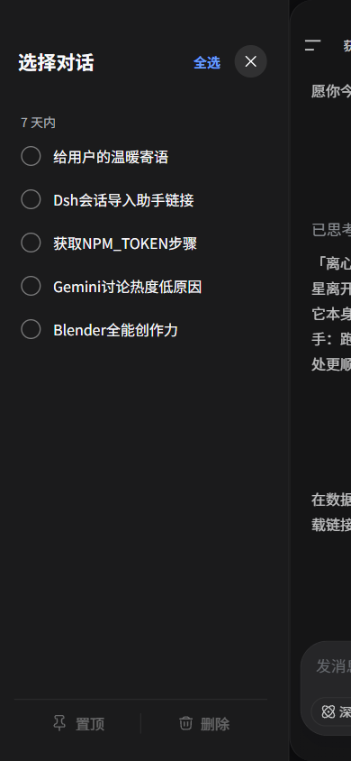
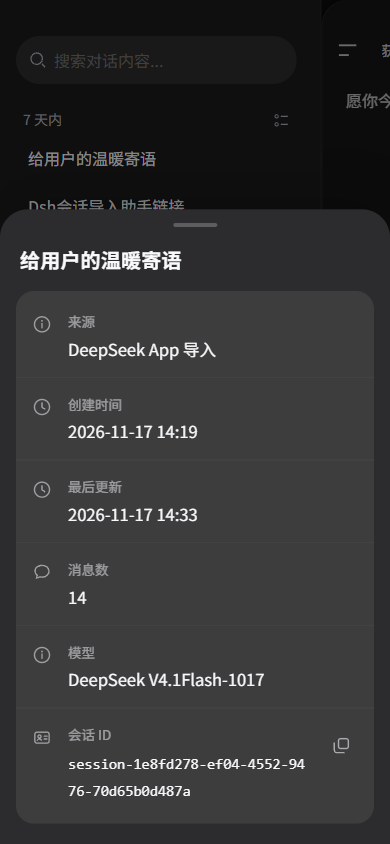
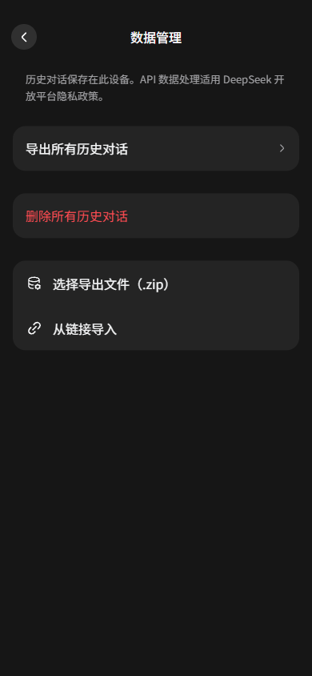
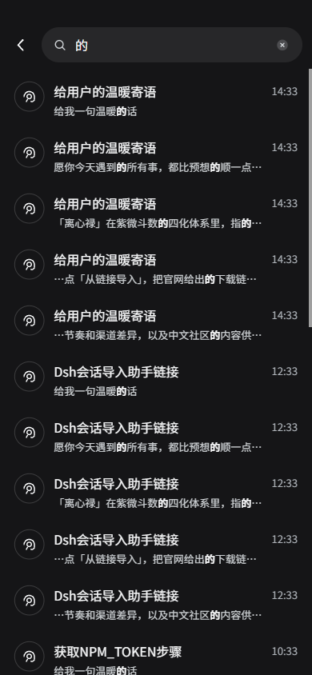
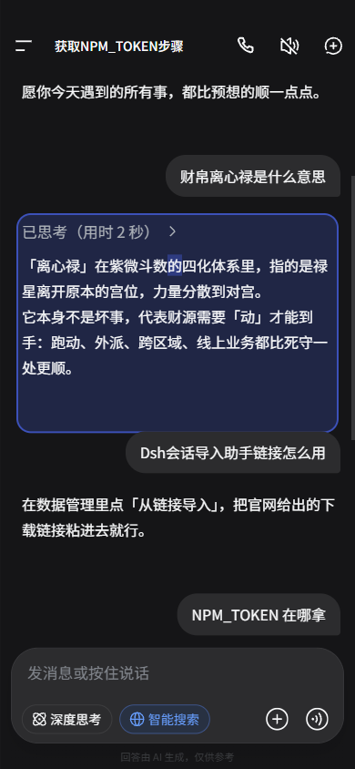

# DeepSleep 使用教程，从装上到用顺手

先说明一下，这软件是我自己攒的，一个把 DeepSeek 网页版搬到手机上、数据全留在本地的壳子。

我不是做产品的，功能也不算花哨，所以这篇不吹，就老老实实教你每一步点哪儿。

你要是第一次装，跟着走完大概十分钟。

## 1、先把安装包装上

安装包在 GitHub 的 releases 页面，文件名长这样 `DeepSleep-0.1.0-build68.apk`，后面那串数字越大越新。

这里有个坑得提前说，之前我给这个软件换过包名，名字叫 `com.deep.sleep`，跟老版本不是同一个应用。

所以你手机上要是还躺着老版的那个鲸鱼图标，两个能同时存在，别装混了。

装完打开，第一屏会是让你填 API Key 的页面。

## 2、填上 API Key

Key 去 DeepSeek 开放平台拿，这是唯一需要你自己准备的东西，软件不内置也不上传，只存在你手机本地。

填完点确认，等它验证一下，通过之后就进聊天页了。

验证不过一般是两种情况，Key 打错了一位，或者账户里没钱了。

## 3、直接开聊就行

底部那个输入框，打字或者按住说话都能用，右边那个加号是发图片、文件、拍照。

深度思考和联网搜索是两个开关，开不开随你，开了回答会更慢一点。

## 4、左边那条栏，是这软件的半条命

点左上角那三条横线，或者从屏幕左边往右滑，侧边栏就出来了。

最上面是搜索框，往下是会话列表，按今天、7 天内、昨天这么分组的。最底下那行是你的账号，点它能进设置。

搜索框右边那个小图标是「选择对话」，点一下整栏就变成多选状态，可以一次勾几条一起置顶或者一起删。

单条会话想重命名、置顶、看详情、删除，长按那一行就行。

详情里有来源、创建时间、消息数、模型和会话 ID。导入进来的会话，创建时间是导出包里的原始时间，不是导入那一刻，这点我觉得挺重要。

## 5、把旧对话搬过来

这一步是很多人最想要的，之前网页版聊了几百条，换手机就没了。

在设置里进数据管理。

两种导入方式，你挑一种。

一是选文件，先在旧的地方把聊天记录导出成 zip，传到手机上，点「选择导出文件（.zip）」。

二是从链接导入，把 DeepSeek 给你的那个下载链接直接粘进来，软件自己去下、自己解压、自己读，不用你去文件夹里翻 zip。

导入会在顶上显示进度条，你可以退出数据管理页，去别的地方晃，进度条跟着你走。

同一条对话重复导入不会变成两条，它按会话 ID 合并，把导出包里新的时间、新的消息条数补上去。

## 6、搜到的东西，点一下就到那一句

这条是我自己用得最多的功能。

搜索框里打一个词，比如「橘鸦」，结果是一条条命中的消息，每条都带上下文和时间。

点任意一条，软件会跳到那条对话，然后精准滚到含这个词的那一句话，并且把那几个字用蓝色标出来。

不是滚到会话开头，也不是滚到会话末尾，就是那句话。之前我做的版本只滚到整条消息，遇到那种几千字的回复就白搭了。

## 7、长对话为什么还记得开头

这部分要说点原理，但我说人话。

软件每次发给模型的内容，顺序是这样的，先是固定的系统提示，然后是一张「开头存档卡」，再往后是一本「事实账本」，最后才是最近的对话。

存档卡是聊满三轮之后生成的，把开头你到底在聊什么、明确提了什么要求，压成一页，之后每次请求都原样带着它，永远不重写。

事实账本是每聊满二十轮，我再压一小块出来，四条，事实、决定、偏好、待办。写进去就不再动了，只在后面接着加。

所以哪怕对话长到几十万字、中间被裁过好几轮，开头那张卡片和账本里的每一块，都还在。

至于那些没进卡片的细节，原文一条没删，还在你手机里，搜一下就能回来看。

顺便解释一个你可能会疑惑的数字，详情里缓存命中率显示一条横线，不是坏了，是你的服务端没返回缓存数据，我不给你瞎编一个 0%。

## 8、几个会遇到的麻烦

装不上，先看是不是跟老的鲸鱼图标应用搞混了，两个包名不一样。

装上打开是黑屏，先卸掉重装一次，我早期有个版本真黑过屏，是我的错，后来的都修了。

横滑没反应，从屏幕中间开始滑，别从最边上起手，边上容易先被系统手势吃掉。

导入失败，先确认链接是 http 或 https 开头的，微信复制过来的链接经常带空格，粘之前扫一眼。

## 最后

这软件还在改，我自己每天在用，遇到不顺手的就改一版。

上面说的每一条，都是我真机试过才写进来的，不是照着功能列表抄的。

要是你按着做卡在某一步，把截图发我，我看看是不是我哪一步没写清楚。
