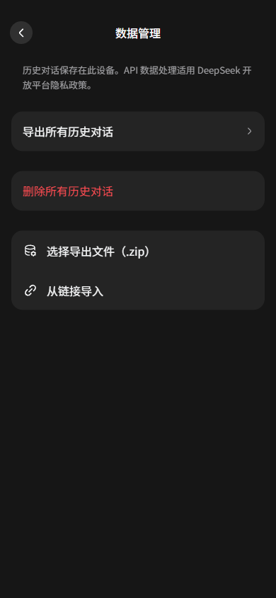
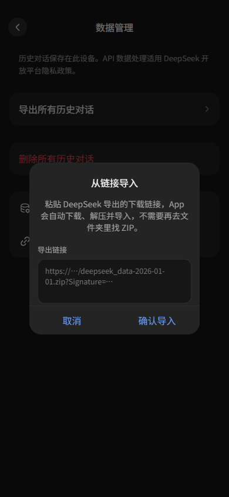
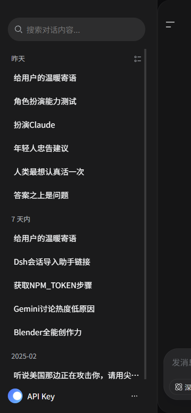

# 把旧对话导进 DeepSleep，两种方法任选

这篇只讲一件事，怎么把你在 DeepSeek 网页版聊过的东西，搬到这个软件里。

换了手机，或者以前一直用网页版，这步基本躲不掉。

我给两种方法，你挑一种就行，不用都做。

## 第 0 步，先去 DeepSeek 官方把数据导出来

不管你用哪种方法，入口都一样，在 DeepSeek 网页版的设置里找数据导出，点一下，它会给你准备一个压缩包。

准备好之后有两种拿法，一种是直接下载到电脑或手机，得到一个 zip 文件。另一种是它给你一个下载链接。

这两种正好对应下面的两种方法。

## 方法一，从链接导入，不用碰文件夹

适合场景，你手上只有那条下载链接，不想折腾文件管理。

先进设置，进数据管理，点「从链接导入」。

弹窗里把链接整条粘进去，注意是整条，从 https 开头一直到最后那串字符都要，中间不能有空格。

粘完点「确认导入」。

这时候页面顶上会出现一条进度条，显示下载中多少、读取中多少。你不用守着它，退出数据管理页也行，去设置里别的地方逛，进度条会跟着你走。

等它跑完，进度条自己消失。

## 方法二，选择导出文件，把 zip 交给自己管

适合场景，zip 已经在你电脑或手机里了，你想自己留着这份备份。

同样进设置，进数据管理，点「选择导出文件（.zip）」。

然后系统会弹文件选择器，你找到那个 zip，选中，就这么简单。

这里有个小提醒，微信、QQ 传过来的 zip 有时候在下载目录里藏得比较深，找不到就去文件管理里搜 `.zip`。

选中之后同样会在顶上显示进度条，跑完就完事。

## 第 3 步，确认真的导进去了

回到侧边栏，看看列表。

导进来的会话会按原来的时间分组，昨天聊的就落在昨天，去年聊的就落在去年的月份里，不会全挤在今天。

点开任意一条，消息条数、顺序、你的提问和它的回答，都在。

## 几个容易卡住的地方

链接导入失败，九成是链接不完整。那条链接后面带一串签名参数，少一个字符都下不来。从微信复制的经常被截断，或者末尾多一个空格。

链接一般有过期时间，官方给的那个链接放几个小时再用就可能失效，失效了回官网重新导一次，拿新的链接。

同一个 zip 导两遍不会变成两份。软件会按会话 ID 认，已经存在的就更新，把导出包里新的时间和消息条数补上去，不会新建一条重复的。

包很大也不用管，它是一边读一边存的，不是把整个包一次性塞进内存。

万一中途失败了，重复上面步骤再导一次就行，之前导进去的不会坏。

## 最后

这两条路我自己都在用，导出包来回导过十几次，没丢过东西。

导入这块我改过好几版，早期版本确实有导不进去的毛病，现在这版是你手上这个包能跑通的。

要是你卡在某一步，把当时的截图发我，我看看是哪一环。

文章里的图都是我自己在软件里截的，不是画的示意图。
